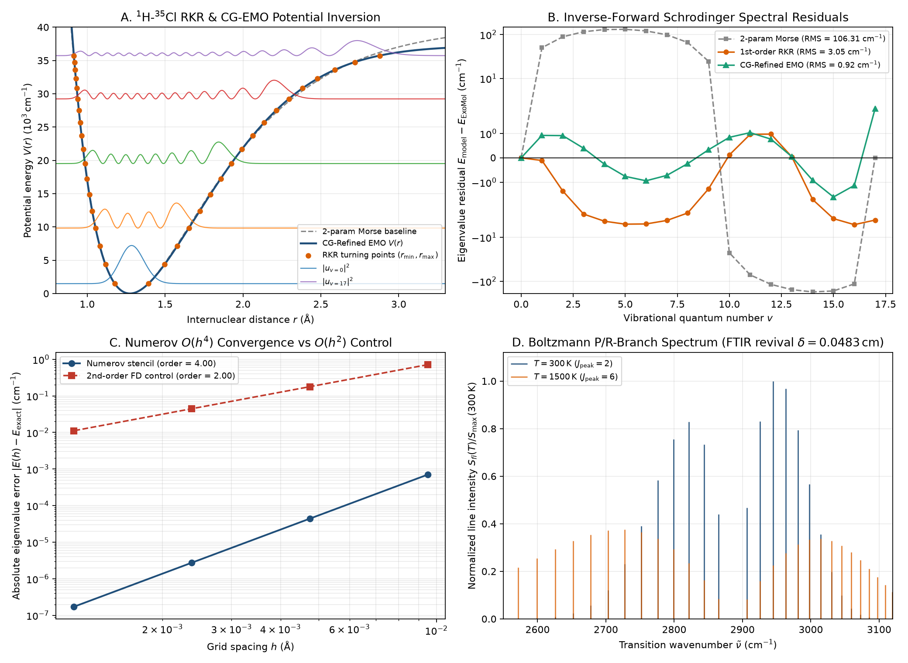

# `exomol-comphys` — Inverse Sturm–Liouville Potential Reconstruction & Diatomic Spectroscopy

From-scratch numerical quantum spectroscopy engine for **PHYS 3178 (Computational Physics 2)** analyzing empirical rovibrational state and transition tables from the [ExoMol database](https://exomol.com) (`1H-35Cl__HITRAN-HCl`, $710$ bound levels and $8,892$ transitions; `12C-16O__Li2015`, $6,383$ bound levels).



---

## Overview & PHYS 3178 Numerical Methods

For $^1\Sigma^+$ closed-shell diatomic molecules ($\text{HCl}$, $\text{CO}$), electronic spin and orbital angular momentum vanish ($S = \Lambda = 0$), so nuclear motion is governed by the 1D radial Sturm–Liouville Schrödinger equation:

$$-C_\mu \frac{d^2 u_{v,J}(r)}{dr^2} + \left[V(r) + \frac{C_\mu J(J+1)}{r^2}\right] u_{v,J}(r) = E_{v,J} u_{v,J}(r), \qquad C_\mu = \frac{\hbar^2}{2\mu}$$

| Module | PHYS 3178 Unit | Numerical Method | Physical / Mathematical Role |
| :--- | :--- | :--- | :--- |
| `src/exomol_comphys/data.py` | Data Ingestion | Quadratic rotational sub-band fit in $J(J+1)$ | Parses `.states.bz2`, `.trans.bz2`, `.pf`; extracts $E(v,0)$ and $B_v$ |
| `src/exomol_comphys/numerov.py` | `003`, `004`, `007`, `008` | Bidirectional $O(h^4)$ **Numerov shooting**, **Sturm node Bisection**, **Cooley Newton update**, 5-pt $O(h^4)$ FD, **Simpson's $1/3$ rule** | Solves radial Schrödinger BVP without exponential blowup in forbidden tails |
| `src/exomol_comphys/rkr.py` | `002`, `004`, `007` | **Dunham expansion** $Y_{kl}$, Newton–Raphson **Gauss–Legendre quadrature**, trigonometric singularity removal | Nonparametric Rydberg–Klein–Rees (RKR) inversion of turning points $(r_{\min}, r_{\max})$ |
| `src/exomol_comphys/invert.py` | `005`, `006` | **Polak–Ribière Conjugate Gradient** + **Brent's line search** + **Hellmann–Feynman Jacobian** | Refines Extended Morse Oscillator $V_{\text{EMO}}(r)$ directly through the Numerov solver |
| `src/exomol_comphys/spectra.py` | `002`, Stat Mech | **Boltzmann partition sum** $Q(T)$, HITRAN line intensities $S_{fi}(T)$, **Cosine FFT / IFFT** | Computes thermal P/R-branch spectra and Michelson FTIR rotational revivals |

---

## Independent Verification Oracles

Every numerical operator is verified in `tests/` against closed-form analytical solutions, conservation theorems, negative controls, and external reference tables:

1. **Closed-Form Morse & $O(h^4)$ Scaling (`test_quantum_solvers.py`)**:
   - Numerov–Cooley eigenvalues match exact Morse levels $E_v = \omega_e(v+\frac{1}{2}) - \omega_e x_e(v+\frac{1}{2})^2$ to $< 5 \times 10^{-9}\text{ cm}^{-1}$ under Richardson extrapolation, with grid-halving ratio $2^4 = 16.00$.
   - *Negative control*: Setting the Numerov $h^2/12$ coefficient to $0$ degrades scaling to $O(h^2)$ (ratio $4.00$) and increases error by $>2000\times$.
2. **Sturm Oscillation, Hellmann–Feynman, & Virial Theorems (`test_quantum_solvers.py`)**:
   - Converged eigenfunctions $u_{v,J}(r)$ have strictly $v$ interior radial nodes and satisfy $\langle u_v | u_{v'} \rangle = \delta_{v,v'}$ to $< 10^{-7}$.
   - Rotational expectation $\langle u_v | C_\mu / r^2 | u_v \rangle$ matches finite-difference $\partial E_{v,J}/\partial[J(J+1)]$ to $< 10^{-7}$.
   - Quantum Virial identity $2\langle \hat{T} \rangle = \langle r V'_{\text{eff}}(r) \rangle$ holds to $< 10^{-7}$ using the matched 5-point $O(h^4)$ derivative stencil.
3. **Machine-Precision RKR Singular Quadrature (`test_quantum_solvers.py`)**:
   - Substituting $x' = x \sin^2\theta$ removes the $(G(x)-G(x'))^{-1/2}$ endpoint singularity, recovering exact analytical Morse turning-point half-widths $f(v) = \frac{1}{2}(r_{\max}-r_{\min})$ to $< 10^{-13}\text{ \AA}$.
4. **Inverse–Forward Potential Reconstruction (`test_exomol_inversion_and_spectra.py`)**:
   - On `1H-35Cl` ($v = 0\dots 17$, spanning $34,241\text{ cm}^{-1}$), a 2-parameter Birge–Sponer Morse model has an RMS residual of **$106.31\text{ cm}^{-1}$**.
   - First-order WKB RKR inversion reduces the forward Numerov RMS residual to **$3.05\text{ cm}^{-1}$**, and Fletcher–Reeves Conjugate Gradient + Brent refinement reduces it to **$0.92\text{ cm}^{-1}$** ($115\times$ reduction).
5. **Boltzmann Partition Function & FTIR Rotational Revivals (`test_exomol_inversion_and_spectra.py`)**:
   - Partition sums $Q(T) = \sum_i g_i e^{-c_2 E_i / T}$ match official ExoMol `.pf` tables to $< 10^{-6}$ (`1H-35Cl`) and $< 10^{-5}$ (`12C-16O`) across $T \in [10, 3000]\text{ K}$.
   - Fundamental $v: 0 \to 1$ R-branch peak shifts from $J = 2$ ($300\text{ K}$) to $J = 6$ ($1500\text{ K}$) and produces a Michelson FTIR revival burst at $\delta_{\text{rev}} \approx \frac{1}{2B_0} = 0.0479\text{ cm}$.

---

## Quickstart

```bash
pytest
python -m exomol_comphys.cli
```

Running `python -m exomol_comphys.cli` writes `outputs/exomol_results.json` and `outputs/exomol_summary.png`.
